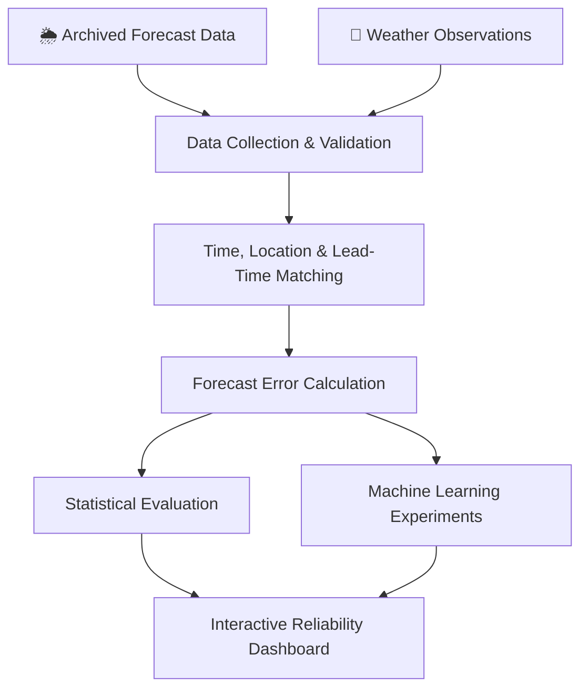

# 🌦️ ForecastGuard AI

### Don't Just Check the Forecast. Check Its Reliability.

**An AI-powered weather forecast verification and reliability analysis platform.**

ForecastGuard AI aims to make weather forecast performance easier to understand by comparing archived forecasts with corresponding weather observations, measuring prediction errors, and exploring reliability patterns across locations and forecast horizons.

\

&#x20; \<strong>Weather Intelligence · Forecast Verification · Machine Learning\</strong>
\

\

&#x20; \
&#x20; \
&#x20; \
&#x20; \
\

---

## 🌍 The Idea

A weather forecast tells us what *might* happen. But how closely have forecasts matched actual weather conditions in the past?

ForecastGuard AI focuses on that second question.

Instead of building yet another weather application, this project is designed to analyze historical forecast performance, measure forecast errors, and investigate when and where forecasts have been less reliable.

The goal is to turn historical weather data into **transparent, measurable, and useful insights**.

## ✨ What Makes It Different?

\<table>
\<tr>
\<td width="50%" valign="top">

### 🎯 Forecast Verification

Compare archived forecasts against appropriately matched weather observations.

\</td>
\<td width="50%" valign="top">

### 📉 Error Intelligence

Measure forecast errors using statistical metrics such as MAE, RMSE, and bias.

\</td>
\</tr>
\<tr>
\<td width="50%" valign="top">

### 🗺️ Regional Analysis

Explore how forecast performance varies by location, weather variable, and forecast lead time.

\</td>
\<td width="50%" valign="top">

### 🧠 ML-Based Error Risk

Investigate whether machine learning can estimate the likelihood of forecast errors exceeding a defined threshold.

\</td>
\</tr>
\</table>

*These are the intended capabilities; implementation and model performance will be verified during development.*

## 🔬 How It Works

The key is **correct verification**: forecasts and observations must refer to the same location, valid time, variable, and appropriate units. The forecast's original issue time and lead time must also be retained.

## 🧩 Platform Modules

| Module                    | Purpose                                                                            |
| ------------------------- | ---------------------------------------------------------------------------------- |
| 📊 Reliability Dashboard  | Explore evaluation metrics and historical performance.                             |
| 🔍 Forecast Analysis      | Compare forecast values with corresponding observations.                           |
| 📈 Historical Trends      | Analyze error patterns over selected periods.                                      |
| 🗺️ Regional Explorer     | Visualize geographical differences in forecast performance.                        |
| 🧠 Error-Risk Experiments | Evaluate models for predicting threshold-based forecast-error risk.                |
| 🔐 User Access            | Provide login and registration interfaces with secure backend integration planned. |

## 🛠️ Technology Stack

\

&#x20; \
&#x20; \
&#x20; \
&#x20; \
&#x20; \
&#x20; \
&#x20; \
&#x20; \
&#x20; \
&#x20; \
\

| Layer            | Planned Tools                                           |
| ---------------- | ------------------------------------------------------- |
| Frontend         | React, TypeScript, Vite, CSS                            |
| Visualization    | Recharts, Leaflet                                       |
| Backend          | Python, FastAPI                                         |
| Data Engineering | Pandas, NumPy                                           |
| Machine Learning | scikit-learn                                            |
| Database         | SQLite for local development; PostgreSQL for production |
| Testing          | Pytest and frontend testing tools                       |
| Version Control  | Git and GitHub                                          |

## 🌐 Data Sources

The project will evaluate suitable data sources based on historical coverage, access conditions, and the availability of comparable records.

- [Open-Meteo Historical Forecast API](https://open-meteo.com/en/docs/historical-forecast-api) — archived forecasts.
- [Open-Meteo Previous Runs API](https://open-meteo.com/en/docs/previous-runs-api) — forecasts from previous model runs.
- [Open-Meteo Historical Weather API](https://open-meteo.com/en/docs/historical-weather-api) — historical weather and reanalysis data.
- [India Meteorological Department](https://mausam.imd.gov.in/) — official Indian meteorological resources.

**Data integrity matters:** reanalysis estimates are not equivalent to direct station observations. The platform will identify the reference data used, disclose coverage limitations, and avoid presenting unverified comparisons as ground truth.

## 📐 Evaluation Approach

The project will investigate established metrics:

- **MAE:** average absolute forecast error.
- **RMSE:** error measure that penalizes larger errors more heavily.
- **Bias:** systematic overprediction or underprediction.
- **Threshold-based error risk:** estimated probability that an error exceeds a specified threshold, if supported by validated data and a suitable model.

Machine learning experiments will use chronological data splits, appropriate baselines, and leakage checks. Performance metrics will be reported only after actual evaluation.

## 🗺️ Development Roadmap

- [ ] Design and build the responsive frontend.
- [ ] Implement backend API structure.
- [ ] Integrate historical forecast and observation sources.
- [ ] Develop forecast-record matching and data-quality checks.
- [ ] Implement statistical forecast verification.
- [ ] Train and evaluate ML error-risk models.
- [ ] Integrate the frontend and backend.
- [ ] Implement and test authentication and security controls.
- [ ] Add automated tests and technical documentation.
- [ ] Deploy and validate the application.

## 🚀 Project Status

**Currently in development.**

The repository will evolve as the frontend, backend, data pipeline, and evaluation methods are implemented. Screenshots, setup instructions, verified results, and a live demo link will be added when available.

## 👩‍💻 Why This Project?

ForecastGuard AI brings together full-stack development, weather-data engineering, statistical evaluation, machine learning, and data visualization in a single applied project.

Its central question is simple:

> **How reliable was the forecast—and what does the evidence tell us?**

---

\

&#x20; \<strong>ForecastGuard AI\</strong>\ 
&#x20; \<em>Measure the forecast. Understand the error. Explore reliability.\</em>
\

